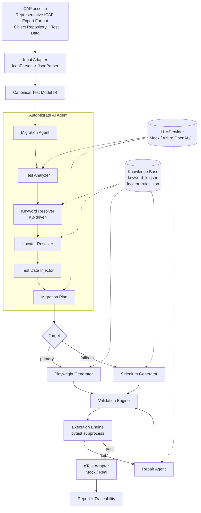
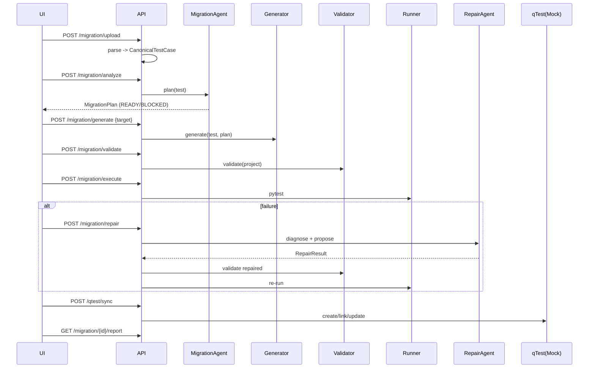

# AutoMigrate AI — Architecture

> Source of truth for requirements: [AutoMigrate_AI_Hackathon_Prototype_Plan.md](AutoMigrate_AI_Hackathon_Prototype_Plan.md).
> This document describes how the prototype will be built: its modules, boundaries, decisions and risks.

---

## 1. Purpose

AutoMigrate AI is a GenAI-assisted migration pipeline. It takes an automation test asset (ICAP, or our normalized sample representation of it) and turns it into an executable **Python Playwright** project (primary target) or a **Python Selenium** project (secondary/fallback target). The generated code is validated, executed and, if needed, repaired. Every result is traced back to the source step.

**Guiding statement:** AI speeds up the migration. Deterministic validation and real test runs check the generated automation. The AI never guarantees correctness on its own.

---

## 2. Architectural Principles

| # | Principle | Consequence |
|---|-----------|-------------|
| P1 | **Canonical Test Model (IR) is the boundary** | Parsers only produce IR. Generators only consume IR. Nothing downstream knows about ICAP. |
| P2 | **The LLM never invents framework APIs** | Playwright and Selenium code comes only from `keyword_kb.json` templates. The LLM analyzes, plans, explains and proposes repairs. It never writes free-form framework calls. |
| P3 | **No invented ICAP formats** | The JSON input is our own documented **Representative ICAP Export Format for Prototype**, labelled as such in every file. `IcapParser` explicitly rejects native ICAP exports (e.g. XML) until their schema is available. |
| P4 | **Explicit failure over silent guessing** | Unsupported keywords, missing locators and unresolved data variables are reported as errors or warnings, never skipped. AI-inferred values are always flagged `ai_inferred=true`. |
| P5 | **Provider isolation** | The LLM sits behind `LLMProvider`. A deterministic `MockLLMProvider` lets the whole demo run offline. |
| P6 | **Adapters for extension** | Source parsers, target generators, runners and qTest are pluggable interfaces. `win_*` and `win_TE_*` are design-only extension points. |
| P7 | **Minimal, transparent repair** | The repair agent may change only the locator or wait of the failing step. Every repair is shown with its reason, the old and new values, a confidence score and the re-run result. |
| P8 | **Hackathon-sized** | No auth, no message queues, no vector DB, no multi-agent orchestration. In-memory or JSON-file storage. |

---

## 3. High-Level Architecture



### Layering (clean architecture)

```text
api/            HTTP (FastAPI routes)          -> depends on services
services/       Use-case orchestration          -> depends on agents, generators, execution, qtest, storage
agents/         Analysis, planning, repair      -> depends on models, knowledge, llm
generators/     IR -> code (template based)     -> depends on models, knowledge
parsers/        Source -> IR                    -> depends on models
execution/      pytest runners                  -> depends on models
qtest/          Test-management adapters        -> depends on models
llm/            LLMProvider implementations     -> no domain deps
knowledge/      JSON KB + loaders               -> no domain deps
models/         Pydantic domain models          -> no deps
```

Dependencies always point inward, toward `models/`. Implementations are wired together through FastAPI dependency injection in `app/dependencies.py`.

---

## 4. Module Catalogue

### 4.1 Models (`backend/app/models/`)

All models use Pydantic v2 with camelCase JSON aliases. The canonical input models reject unknown fields. Field names are source-neutral: nothing is named `icap_*`, and provenance lives in `SourceInfo`.

| Model | Key fields | Enforced invariants |
|-------|-----------|---------------------|
| `SourceInfo` | `system` (e.g. ICAP), `format` (e.g. representative-icap-export/1.0), `reference` (file name only) | Non-blank |
| `Locator` | `name, strategy, value, source (OBJECT_REPOSITORY/USER/AI_INFERRED/AI_REPAIRED), confidence?` | AI-sourced locators must state a confidence and non-AI locators must not. `id` has no whitespace. `xpath` starts with `/`, `(` or `.`. `screen-position` is `row,col` |
| `TestStep` | `sequence, keyword, object?, value?, expected?, block_id?, source_step_ref?, metadata` | `sequence >= 1`. Keyword is an identifier. Exposes `variable_references` |
| `ReusableBlock` | `block_id, name, steps` | At least one step; sequences strictly increasing |
| `TestData` | `variables: dict[VarName, str], sensitive_keys` | Valid variable names. Accepts a flat mapping. `is_sensitive()` and `masked()` hide secrets from the UI and LLM |
| `CanonicalTestCase` | `test_case_id, name, application_type (WEB/WINDOWS/TERMINAL_EMULATOR), steps, test_data, reusable_blocks, object_repository, source?` | Steps strictly increasing. Block IDs unique and every referenced block defined. Repository key equals locator name. Locator strategy valid for the application type. Missing objects and unresolved variables are *reported* (`missing_objects()`, `unresolved_variables()`), not rejected, so planning can show them |
| `MigrationPlan` | counts, `unsupported_keywords, future_adapter_keywords, missing_locators, unresolved_variables, warnings, errors` | `status` and `blocking_reasons` are **computed**, so a plan cannot claim READY while blocked. An application type with no supported target is always BLOCKED |
| `GeneratedArtifact` / `MigrationResult` | `path, kind, content, step_line_map` / `artifacts, output_dir` | Paths are relative POSIX paths with no `..` or drive letter. Paths are unique. At least one TEST artifact |
| `ValidationResult` | per-check `CheckStatus` + `issues[]` | Overall `status` is computed. ERROR issues require a FAIL check, WARNING issues a WARN or FAIL check |
| `ExecutionResult` | `status, target, started_at, duration, attempt, stdout/stderr, failed_step?, error_*?, screenshots` | PASS carries no failure details. Non-PASS must include an error |
| `RepairProposal` / `RepairResult` | `change_type (LOCATOR/WAIT), old/new value, confidence, diagnosis` / `status (PROPOSED/REJECTED/APPLIED/VERIFIED/FAILED), validation_status, re_execution` | The proposal must change the value. VERIFIED needs a passing re-run and FAILED a failing one. Unapplied repairs have no outcomes. Re-run target must match |
| `TraceabilityRecord` / `QTestLink` | `source_test_case_id, source_step_ref, step_sequence, keyword, generated_file:line, execution_status, qTestCaseId` | A line number requires a file |
| `MigrationMetrics` | `manual_estimate_minutes, ai_migration_seconds` | `observed_time_saving_percent` is computed from measured values only |
| `MigrationRecord` | per-target plans, results, validations, executions; repairs; qTest links | Each item matches its target key, migration ID and test case |

**Future adapters:** [capabilities.py](backend/app/models/capabilities.py) maps each `ApplicationType` to its valid locator strategies and supported target frameworks. Windows (`automation-id`, `class-name`, `name`, `xpath`) and terminal-emulator (`screen-position`, `field-label`) tests can already be *modelled*. They have no target framework yet, so their plans are BLOCKED. Adding an adapter means adding its target to `SUPPORTED_TARGETS` and implementing a generator and runner.

### 4.2 Parsers (`backend/app/parsers/`)

- `BaseParser.parse_all(test_case, *, test_data=None, object_repository=None, source_name=None) -> list[CanonicalTestCase]`. `parse(...)` returns exactly one test case. Inputs may be `str` or `bytes` (UTF-8, BOM tolerated).
- `IcapParser` (**entry point**, used by `MigrationService`) detects the input format. JSON is routed to `JsonParser`. XML and other inputs raise `UnsupportedFormatError` with guidance; nothing about native ICAP formats is assumed.
- `JsonParser` (**MVP**) converts the Representative ICAP Export Format (Section 6):
  - Safe JSON loading: duplicate keys, `NaN`/`Infinity`, non-object roots and excessive nesting are rejected, and syntax errors report line and column.
  - Header check: `format` label, `formatVersion` and `documentType` must match.
  - Structural validation through strict Pydantic "raw" models: unknown keys, wrong types, `sequence` not an integer of at least 1, and steps without exactly one of `keyword` or `blockRef` are all errors.
  - Keyword validation through `KeywordCatalog` (`keyword_kb.json`):
    - Unknown keywords are rejected, with "did you mean" suggestions.
    - A keyword must belong to the test's application type.
    - KB `requires` fields (`object`, `value`, `expected`) must be present.
    - `win_*` and `win_TE_*` keywords are accepted only in WINDOWS and TERMINAL_EMULATOR tests, so planning can report them as future adapters.
  - Reusable blocks are expanded inline, including nested blocks, with cycle and depth (5) detection. Canonical steps are renumbered 1..n and keep `block_id` and a traceable `source_step_ref`, e.g. `2/BLK-LOGIN#3` (source step 2 → block BLK-LOGIN, step 3).
  - Shared resources are merged:
    - Object repository: document + test case + external file. Identical duplicates are fine; conflicting definitions are errors.
    - Test data precedence: external file > test case > document. Sensitive keys are unioned.
  - All problems are collected and raised together in one `ParserError.errors` list, prefixed with the test case ID and the step path.
  - `${VAR}` placeholders are kept. Missing objects and unresolved variables are *not* parse errors; planning reports them.
- `XmlParser` and `CsvParser` are **future** work. They plug into `IcapParser` routing once a documented ICAP schema exists.

### 4.3 Knowledge Base (`backend/app/knowledge/`)

- `keyword_kb.json` maps each keyword to a description, an application type, the required fields and per-target templates.
- `locator_rules.json` maps each locator strategy to Playwright selector syntax and a Selenium `By.*` constant.
- `framework_templates.json` holds project scaffolding: conftest, pytest.ini, requirements and the page-object skeleton.
- `coding_standards.json` lists allowed imports, naming rules and required assertion presence.

MVP keywords: `web_navigate, web_click, web_setText, web_getText, web_assertText, web_wait, web_select`.

`web_wait` is in the MVP list but has no mapping in the plan. **Assumption:** it means "wait until the element is visible" (with an optional timeout in `value`). This must be confirmed against ICAP semantics.

`win_*` and `win_TE_*` appear in the KB with `"status": "FUTURE_ADAPTER"` and no target templates. They are detected and reported but never converted.

**Template safety:** values are inserted as Python literals with `repr()`, never with raw string formatting. This stops quotes or code in test data or locators from breaking or injecting into the generated code.

### 4.4 Agents (`backend/app/agents/`)

| Component | Deterministic? | LLM role |
|-----------|---------------|----------|
| `TestAnalyzer` | Counts and classification are deterministic | Optional: plain-language summary of the test's intent |
| `KeywordResolver` | Fully deterministic (KB lookup). Unsupported keywords cause an explicit error | None |
| `LocatorResolver` | Deterministic (repository + `locator_rules.json`) | None at generation time. Missing locators are flagged, not invented |
| `TestDataInjector` | Deterministic `${VAR}` resolution. Unresolved variables cause an error | None |
| `MigrationPlanner` | Fully deterministic: builds `MigrationPlan` from the analysis, KB, locator and test-data checks | None. AI text is attached as `aiAnalysis` but cannot change counts or status |
| `MigrationAgent` | Orchestrates analyze → plan → generate → syntax gate and selects the generator | None directly; the LLM is only reached through `TestAnalyzer` |
| `RepairAgent` | Gets the failing step, generated code, failed locator, error, object repository and the candidate locators parsed from the failure-time DOM | Picks one DOM candidate by id and explains it (structured JSON). Repaired code is regenerated by the KB generator with only that locator (or one wait) changed; the diff is checked to touch nothing else. A deterministic heuristic is used when the LLM is unavailable or its answer is invalid. Assertion failures are never "repaired" |

All agent outputs are Pydantic models serialized as JSON. There are no free-text contracts.

### 4.5 LLM (`backend/app/llm/`)

- `LLMProvider.generate(prompt, context) -> str` and `generate_json(prompt, context, schema) -> model`. `context["task"]` names the request; providers raise `LLMError` for every failure
- `MockLLMProvider` is deterministic and rule-based. It is the default, so the demo works with no network.
- `AzureOpenAIProvider` is selected with `LLM_PROVIDER=azure_openai` in `.env`. Keys come from the environment only. Other providers are added by implementing `LLMProvider` and registering a builder in `llm/factory.py` `PROVIDERS`.
- LLM JSON output is validated against the schema. Invalid output is rejected and the system falls back to the deterministic path.

### 4.6 Generators (`backend/app/generators/`)

- `BaseGenerator` holds the shared logic: project layout, page-object grouping, test-data file and step-to-line mapping.
- `PlaywrightGenerator` and `SeleniumGenerator` differ only in the KB target key and the scaffolding templates. No business logic is duplicated.
- Output goes to `generated/<target>/<migration_id>/` with the layout from plan Section 12.
- Each generated step carries a `# [AM-STEP n] <keyword> <object>` marker, which is used for traceability and repair.

### 4.7 Validation (`backend/app/validation/` + `services/validation_service.py`)

`ValidationEngine` reads the generated project from disk and runs these validators. Each check is PASS, WARNING or FAIL, with located reasons (`file:line (step n): message`) in `ValidationResult.checks`.

| Validator | Checks |
|-----------|--------|
| `SyntaxValidator` | `syntax`: every `.py` compiles; test data JSON parses |
| `ImportValidator` | `imports`: allow-list from `coding_standards.json`, project modules/names exist, pyflakes undefined names (FAIL) and unused imports (WARNING). `framework`: target supports the application type, no imports, fixtures or requirements from the other framework, `conftest.py`/`pytest.ini`/`requirements.txt` present |
| `KeywordValidator` | `keywords`: every source step has a KB mapping and an `[AM-STEP n]` block; assumed semantics warn. `variables`: every `${VAR}` has a value, is in the test data file and is resolved at runtime; hard-coded secrets warn |
| `LocatorValidator` | `locators`: every object resolves, tests only use page-object constants that exist; AI-sourced locators warn |
| `StandardsValidator` | `assertions` per test, `duplicates` (repeated steps or tests), `standards`: forbidden calls, `time.sleep`, line length, test naming |

### 4.8 Execution (`backend/app/execution/`)

- `ExecutionEngine.execute(target, project_dir, attempt) -> ExecutionResult` dispatches to `PlaywrightRunner` / `SeleniumRunner`.
- Fixed command `[sys.executable, "-m", "pytest", "-p", "no:cacheprovider", "--junitxml=...", "-o", "log_file=...", <headed flag>]`, no shell, `cwd=<project>`. On timeout the whole process tree is killed and the result is `TIMEOUT`.
- **No user-supplied command strings.** The project must resolve inside `generated/<target>/` (no traversal or symlink escape) and contain `pytest.ini` and `tests/`. Server secrets (`*API_KEY*`, `*TOKEN*`, `*SECRET*`, `*PASSWORD*`, except `AM_DATA_*` test data) and `PYTEST_ADDOPTS` are removed from the child environment.
- Each run writes to its own `artifacts/runs/<timestamp>-attemptN/` (`AM_ARTIFACTS_DIR`): JUnit XML, `test-run.log` and failure screenshots from the generated conftest.
- `ExecutionResult` holds status (PASS/FAIL/ERROR/TIMEOUT), exit code, duration, stdout, stderr, logs, test counts, screenshots and the failing `[AM-STEP n]` mapped from the traceback.
- `ExecutionService` runs only generated projects whose validation is PASS or WARNING.
- Playwright runs headless Chromium. Selenium runs headless Chrome through Selenium Manager.

### 4.9 Demo Application (`demo_app/`)

A small local web app with login and welcome pages, served by FastAPI at `/demo` on port 8001 (port 8000 is reserved by Windows on the development machine). Tests never reach the public internet. A toggle (`?variant=v2`, or the path `/demo/v2/login`, so `AM_DATA_BASE_URL=http://localhost:8001/demo/v2` switches a generated test) renames `#loginBtn` to `[data-testid="login"]`. This reproduces the locator-failure and repair scenario on demand.

**Self-healing loop** (`services/repair_service.py`): last failed run -> `RepairAgent` proposal -> validate repaired artifacts (FAIL => `REJECTED`, nothing written) -> write -> re-run -> `VERIFIED`, or `FAILED` with the original files restored. Every attempt is kept in `MigrationRecord.repairs`; the source test is never modified, and verified repairs are replayed by `current_test_case()`. `RepairResult.timeline` gives the UI Original -> Failure -> AI Analysis -> Repair -> Validation -> Re-run -> PASS/FAIL.

### 4.10 qTest (`backend/app/qtest/`)

- `BaseQTestAdapter`: `create_test_case`, `link_automation`, `update_execution`, `publish_result`; `is_mock` and `display_name` for UI labelling. Selected by `create_qtest_adapter()` (`QTEST_MODE`, default `mock`).
- `MockQTestAdapter` (**MVP**) issues `QT-1001` / `QR-1` IDs, persists to `data/mock_qtest.json`, never touches the network and marks every result `mock: true`. The UI labels it **"Mock qTest"**.
- `QTestAdapter` (real) validates its configuration but **never sends or simulates a call**: every operation raises `QTestUnavailableError` (HTTP 501) until the qTest Manager API and field mapping are confirmed.
- `QTestService.sync` links each generated script and its latest run (logs, JUnit, screenshots as workspace-relative paths) to one qTest case per source test, then publishes; re-syncs are idempotent. `traceability()` returns ICAP test case <-> generated script/line <-> qTest case <-> execution status <-> logs/screenshots, per script and per step.

### 4.11 Services, API, Storage

- `MigrationService`, `ValidationService`, `ExecutionService`, `RepairService`, `ReportService`, `QTestService`
- `MigrationStore` holds one `MigrationRecord` per migration. `InMemoryMigrationStore` is implemented. JSON persistence to `data/` is a TODO.
- Wiring lives in `app/dependencies.py`. Unimplemented features raise `NotImplementedError`, which the API maps to HTTP 501.
- API endpoints follow plan Section 19, under `/api`.
- Uploads are limited to `.json`, max 1 MB, parsed with `json` (no eval) and stored under a generated ID, never under the user's filename.

### 4.12 Frontend

Dashboard panels: Upload → Migration Plan → Target select → Generated Code → Validation → Execution → AI Repair (diff) → Traceability → qTest → Metrics.

- **Preferred:** React + Vite. This requires Node.js, which is **not installed** on the current machine.
- **Zero-toolchain fallback:** a single-page HTML/JS dashboard (no build step) served by FastAPI at `/`.
- Metrics come from measured timestamps. The manual-effort baseline is a configurable input, not a hard-coded claim.

---

## 5. End-to-End Flow



---

## 6. Representative ICAP Export Format for Prototype (our own, MVP input)

This is **not** an official or proprietary ICAP format. It is our documented JSON layout for the ICAP concepts named in the plan: test cases, steps/keywords, test data, reusable blocks and object repository. The models live in [representative_format.py](backend/app/parsers/representative_format.py).

Every file starts with the same header. `documentType` selects one of three document kinds:

| `documentType` | Content | Sample |
|----------------|---------|--------|
| `TEST_CASE` | One test case at the top level, **or** a suite in `testCases[]` with shared `reusableBlocks` / `objectRepository` / `testData` | [login_test.json](samples/icap/login_test.json) (self-contained), [checkout_test.json](samples/icap/checkout_test.json) (uses shared files) |
| `TEST_DATA` | `testData` (string/number values), optional `sensitiveKeys` | [sample_testdata.json](samples/icap/sample_testdata.json) |
| `OBJECT_REPOSITORY` | `objectRepository: {name: {type, value, description?}}` | [sample_object_repository.json](samples/icap/sample_object_repository.json) |

```json
{
  "format": "Representative ICAP Export Format for Prototype",
  "formatVersion": "1.0",
  "documentType": "TEST_CASE",
  "testCaseId": "ICAP-TC-001",
  "name": "Login Test",
  "description": "optional",
  "applicationType": "WEB",
  "steps": [
    { "sequence": 1, "keyword": "web_navigate", "value": "${BASE_URL}/login", "description": "optional" },
    { "sequence": 2, "blockRef": "BLK-LOGIN" },
    { "sequence": 3, "keyword": "web_assertText", "object": "welcomeMessage", "expected": "Welcome" }
  ],
  "reusableBlocks": [
    { "blockId": "BLK-LOGIN", "name": "Login", "steps": [
      { "sequence": 1, "keyword": "web_setText", "object": "username", "value": "${USERNAME}" },
      { "sequence": 2, "keyword": "web_setText", "object": "password", "value": "${PASSWORD}" },
      { "sequence": 3, "keyword": "web_click", "object": "loginButton" }
    ]}
  ],
  "objectRepository": { "username": { "type": "id", "value": "username" } },
  "testData": { "USERNAME": "demo_user", "PASSWORD": "demo_password" },
  "sensitiveKeys": []
}
```

Locator `type` values: `id`, `css`, `xpath`, `name` and `data-testid` for WEB. Windows and terminal-emulator types are listed in Section 4.1.

---

## 7. MVP vs Future

| Area | MVP (build) | Future (design only) |
|------|-------------|---------------------|
| Source | Representative ICAP Export Format (JSON) | Native ICAP export (XML or other), CSV, ICAP API |
| Keywords | 7 `web_*` keywords | `win_*` (e.g. pywinauto adapter), `win_TE_*` (terminal emulator adapter) |
| Targets | Playwright Python, Selenium Python | TS/Java/C# targets |
| AI | Plan narrative, repair proposals, Mock + one real provider | RAG/vector KB, multi-agent |
| Repair | Locator/wait repair of one failing step | Multi-step, data or flow repairs |
| qTest | Mock adapter | Real qTest REST integration |
| Storage | In-memory + JSON files | Database |
| UI | Single dashboard | Multi-user, auth, batch migration |
| Packaging | venv + scripts | Docker / docker-compose (Docker not installed locally) |

---

## 8. Dependencies

**Backend (Python 3.12, installed):** `fastapi`, `uvicorn[standard]`, `pydantic>=2`, `pydantic-settings`, `python-multipart`, `pyflakes`, `pytest`, `pytest-playwright`, `playwright`, `selenium>=4.11` (includes Selenium Manager), `httpx2` (Starlette test client), and optionally `openai` (Azure/OpenAI provider).

**Runtime:** Chromium for Playwright (`python -m playwright install chromium`) and Google Chrome for Selenium.

**Frontend (optional):** Node.js 18+, React, Vite.

**Not available locally:** Node.js, npm, git, Docker.

---

## 9. Risks & Assumptions

### Risks

| Risk | Impact | Mitigation |
|------|--------|-----------|
| Real ICAP export format is unknown | Parser may not match real assets | Our own documented format, a stub `IcapParser`, and a mapping workshop once a sample is available |
| `playwright install` or Selenium Manager driver downloads are blocked by the corporate proxy | Execution cannot run | Pre-download browsers, set `PLAYWRIGHT_DOWNLOAD_HOST`/proxy, use the local Chrome channel (`--browser-channel chrome`) |
| Enterprise LLM access or keys not available on demo day | AI features look absent | `MockLLMProvider` default. The real provider is opt-in |
| LLM returns invalid or hallucinated output | Wrong code or repair | Schema validation, restricted repair scope, KB-only code, re-validation and re-run |
| Workspace sits in **OneDrive** with spaces in the path | Sync locks on venv, node_modules and generated files; path quoting bugs | Recommend moving to a non-synced folder such as `C:\dev\automigrate-ai`, quoting all paths and excluding `generated/` and `.venv` |
| No Node.js | React UI cannot be built | Install Node LTS, or use the no-build HTML dashboard |
| No git | No version control or team collaboration | Install Git for Windows before coding starts |
| Unclear `web_wait` and `web_getText` semantics (where the result is stored) | Incorrect mapping | Documented assumptions: `web_getText` stores the result in a named runtime variable from `value` |
| Code injection through test data or locators | Malicious generated code | `repr()` literal insertion, AST validation, import allow-list |

### Assumptions

1. A WEB-only demo is enough for judging.
2. The demo runs against the local demo app, not a third-party site.
3. Headless Chromium and Chrome are available or installable.
4. One test case per upload in the MVP. Batch mode is future work.
5. Credentials in test data are demo values. Values for keys named `PASSWORD`, `TOKEN` or `SECRET` are masked in UI and reports.

---

## 10. Security Notes (OWASP-aligned)

- No `shell=True`. pytest runs with fixed arguments in a sandboxed `generated/` path, with path traversal checks.
- Uploads: extension and size limits, JSON parsed safely, server-generated IDs.
- Secrets only via `.env` (git-ignored). `.env.example` contains no real values.
- Generated code is checked against the import allow-list before execution.
- CORS is restricted to the local dashboard origin.
- LLM prompts never include secrets. Test-data values are masked before they are sent.
